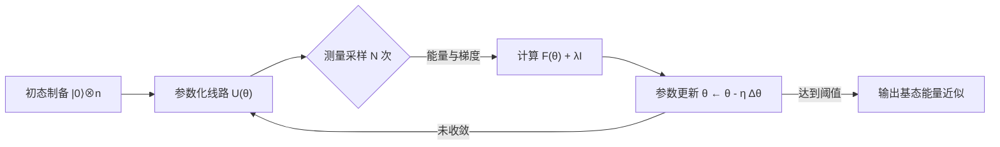

# 变分量子优化收敛性实验简报

本示例用于验证浅色科研排版、自动目录（TOC）、LaTeX 公式渲染、学术三线表、Mermaid 流程图以及轻量数据可视化。

## 1. 问题定义与目标函数 $L(\theta)$

考虑含参量子线路 $U(\theta) = \prod_{l=1}^{L} W_l \exp(-i \theta_l H_l)$，给定观测量 $O$，优化目标为最小化期望能量：

$$
L(\theta) = \langle 0 | U^\dagger(\theta)\, O\, U(\theta) | 0 \rangle, \qquad \theta \in \mathbb{R}^d
$$

参数更新采用自然梯度与标准一阶方法对比，Fisher 信息矩阵元素记作 $F_{ij}(\theta)$：

\begin{align}
g_i(\theta) &= \frac{\partial L(\theta)}{\partial \theta_i} = \frac{1}{2}\big[L(\theta + \tfrac{\pi}{2} e_i) - L(\theta - \tfrac{\pi}{2} e_i)\big] \\
\theta^{(t+1)} &= \theta^{(t)} - \eta \, \big(F(\theta^{(t)}) + \lambda I\big)^{-1} g(\theta^{(t)})
\end{align}

注意：文本中的价格表述如 $5 或 $10 不会被误识别为公式，而含下标的行内公式 $a_i + b_j = c_{i,j}$ 也不会被 Markdown 斜体规则破坏。

## 2. 实验流程



## 3. 主要指标对比（三线表）

表 1：在 12-qubit TFIM 模型（$J = 1.0, h = 0.8$，10 组随机种子）上的收敛结果对比。

| 优化器 | 最终误差 $\Delta E$ | 达到 $10^{-3}$ 所需步数 | 单步测量预算 | 收敛稳定性 |
| :--- | :---: | :---: | :---: | ---: |
| SGD ($\eta = 0.05$) | $4.8 \times 10^{-3}$ | $> 200$ | $1 \times$ | 中等 |
| Adam | $1.6 \times 10^{-3}$ | $168$ | $1 \times$ | 较好 |
| QNG ($\lambda = 10^{-2}$) | $3.1 \times 10^{-4}$ | $64$ | $2.4 \times$ | 高 |

## 4. 收敛曲线可视化

```chart
{
  "type": "line",
  "title": "不同优化器能量误差收敛对比（均值）",
  "labels": ["0", "25", "50", "75", "100", "125", "150", "175", "200"],
  "xLabel": "迭代步数 (Iterations)",
  "yLabel": "能量误差 ΔE",
  "series": [
    { "name": "SGD", "data": [0.42, 0.24, 0.14, 0.085, 0.052, 0.031, 0.018, 0.0095, 0.0048] },
    { "name": "Adam", "data": [0.42, 0.18, 0.082, 0.039, 0.019, 0.0092, 0.0041, 0.0021, 0.0016] },
    { "name": "QNG (Ours)", "data": [0.42, 0.095, 0.019, 0.0042, 0.0014, 0.00068, 0.00042, 0.00034, 0.00031] }
  ]
}
```

### 4.1 关键更新代码片段

```python
def qng_step(theta, grad, fisher, lr=0.08, damping=1e-2):
        reg_fisher = fisher + damping * np.eye(len(theta))
        direction = np.linalg.solve(reg_fisher, grad)
        return theta - lr * direction
```
